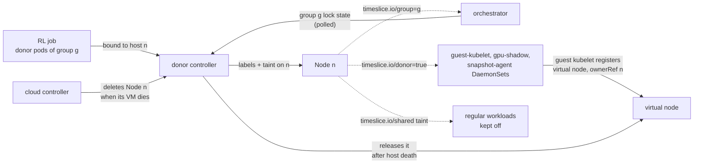

# Donor Controller

> [!WARNING]
> The donor controller is a prototype. It is off by default in the parent
> chart (`donor-controller.enabled: false`), and it has no published image
> yet, so you build your own.

When an RL job's donor pods land on a host, the donor controller marks that
host as *shared*, for that job's time-slicing group. Once the group's donor
pods are gone, its lock has gone idle and a grace period has passed, it marks
the host as ordinary again. The labels and the taint it writes are the signal
the rest of the system reacts to:

- the guest-kubelet, gpu-shadow and snapshot-agent DaemonSets follow the
  donor label onto shared hosts, and off them again;
- the orchestrator adds shared hosts to their group;
- regular workloads stay off them.

Guests borrow the host; they never keep it. When the label goes, the
guest-kubelet DaemonSet pod goes, and its virtual node with it.

The controller only ever writes to Node objects (plus Events). It owns:

- two labels and one annotation on each host it shares, written with
  server-side apply;
- one taint (optional), written with a merge patch;
- the virtual nodes of hosts that have died, which it deletes and whose
  finalizer it removes.

## Guides

| Guide | Use it to |
| --- | --- |
| [KIND lab](kind.md) | Try every journey on a laptop in about 30 minutes, with no GPUs or cloud account. Also covers running the integration suite and the controller from source |
| [GKE](gke.md) | Stand up a GPU cluster with the whole stack (DRA driver, orchestrator, snapshot agent, donor controller) through the parent Helm chart, then watch the controller work on real hosts, including a real VM death |

For the code, see the [package README](../../pkg/donor-controller/README.md);
for the Helm values, see the [chart README](../../deploy/donor-controller/README.md).

---

## How the pieces react to each other



The controller re-evaluates one host at a time, triggered by any change to
the host Node, one of its virtual nodes, or a donor pod bound to it, and by a
poll of its group's lock while it waits to unshare. Each evaluation runs six
rules and applies the union of what the matching rules assert. Whatever no
rule asserts any more is released.

| Rule (as it appears in Events and errors) | When | Then |
| --- | --- | --- |
| `share node while donor pods are bound` | Donor pods of the host's group are bound to it. The group is the one already on the Node, else the oldest donor pod's | Donor and group labels, isolation taint |
| `reject donor pods outside the node's group` | Donor pods of another group, or with no valid group, are bound to it | `GroupConflict` or `InvalidGroup` Warning Events on each such pod and on the host. Nothing else changes |
| `keep node shared while group lock is active or unknown` | Shared, no donor pods of its group, but the group's lock is held, switching, or unreadable | Keep everything. An active lock clears `idle-since`; an unknown one keeps it as is |
| `keep node shared during idle grace period` | Shared and idle, grace period not over | Keep everything, stamp `idle-since`, wake up when the grace period ends (and every poll interval, to watch the lock) |
| `unshare node after idle grace period` | Shared and idle for the whole grace period | Check the API server and the orchestrator (not caches) for donor pods and lock activity, then release everything |
| `release virtual nodes of dead host` | A virtual node's owner host Node is gone, or was recreated with a new UID | Check the API server that the host is gone, delete the virtual node, remove its `timeslice.io/virtual-node-protection` finalizer |
| `wait out stale gpu fence` | The host has the guest kubelet's `timeslice.io/gpu-fence=<virtual node>` taint, that virtual node is gone, and no mirror pod is bound to the host. Grace period (`--stale-fence-grace`) not over | Stamp `timeslice.io/stale-fence-since`, wake up when the grace period ends. The virtual node or a mirror coming back releases the stamp |
| `remove stale gpu fence` | Same, for the whole grace period | Check the API server that the virtual node is gone and no mirror pod is bound, then remove the fence (only that taint, only if unchanged) and release the stamp |

## The contract

| Key | On | Written by | Meaning |
| --- | --- | --- | --- |
| `timeslice.io/donor=true` | Pod | RL job (or the webhook) | This pod donates the host it's bound to |
| `timeslice.io/group=<g>` | Pod | Webhook | The host should join time-slicing group `g`. Required: a donor pod without a valid group shares nothing |
| `timeslice.io/virtual-node=true` | Node | Guest kubelet | This Node is a virtual node. Its name doesn't matter (`vk-<hash>` is fine) |
| ownerReference `{v1, Node, <host>, <host uid>}` | Virtual node | Guest kubelet | Names the virtual node's host |
| finalizer `timeslice.io/virtual-node-protection` | Virtual node | Guest kubelet | Keeps the virtual node, and its guests, through a guest kubelet outage. The donor controller removes it only once the host is gone |
| `timeslice.io/donor=true` | Node | Donor controller | The host is shared |
| `timeslice.io/group=<g>` | Node | Donor controller | The host's one group. The orchestrator reads it with `--node-group-labels=ns` or `either` |
| `timeslice.io/idle-since=<RFC 3339>` | Node | Donor controller | The idle clock. It lives on the Node, so it survives restarts |
| Isolation taint, such as `timeslice.io/shared=true:NoSchedule` | Node | Donor controller | Optional (`controller.isolationTaint`). Everything meant to run on shared hosts must tolerate it |

The field manager is `timeslice-donor-controller`.

## Observing the controller

Both guides use these commands. They assume the controller runs in
`timeslice-system` with its pods labeled
`app.kubernetes.io/name=donor-controller`.

```bash
# Shared hosts with their group, idle clock and taints
kubectl get nodes -l timeslice.io/donor=true \
  -o custom-columns='NAME:.metadata.name,GROUP:.metadata.labels.timeslice\.io/group,IDLE-SINCE:.metadata.annotations.timeslice\.io/idle-since,TAINTS:.spec.taints[*].key'

# Virtual nodes and their hosts
kubectl get nodes -l timeslice.io/virtual-node=true \
  -o custom-columns='NAME:.metadata.name,HOST:.metadata.ownerReferences[0].name,FINALIZERS:.metadata.finalizers'

# Group conflicts and other warnings
kubectl get events -A --field-selector source=donor-controller,type=Warning

# Every write, with the rule that caused it (Node Events live in "default")
kubectl get events -n default --field-selector source=donor-controller --sort-by=.lastTimestamp

# Exactly which fields the controller owns on a host
kubectl get node "$NODE" --show-managed-fields \
  -o jsonpath='{range .metadata.managedFields[?(@.manager=="timeslice-donor-controller")]}{.operation}{" "}{.fieldsV1}{"\n"}{end}'

# Write log: applied / tainted / untainted / deleted / removed finalizer /
# warned / would ... (dry run).
# Leader-election lines are plain text, hence fromjson?.
kubectl -n timeslice-system logs -l app.kubernetes.io/name=donor-controller --tail=-1 \
  | jq -cR 'fromjson? | select(.msg | test("applied|tainted|untainted|deleted|finalizer|warned|would|precondition|stale")) | {time, msg, ref: .ref.Name, node, key, rules, rule, object} | with_entries(select(.value != null))'

# Who is the leader
kubectl -n timeslice-system get lease donor-controller.timeslice.io -o jsonpath='{.spec.holderIdentity}{"\n"}'

# Reconcile counters (run the port-forward against the leader pod)
kubectl -n timeslice-system port-forward "pod/${LEADER%%_*}" 8080:8080
curl -s localhost:8080/metrics | grep -E '^controller_runtime_reconcile_(total|errors_total)\{.*donor-controller'
```

## Known limits

- **Uninstalling leaves labels behind.** Removing the controller doesn't
  unshare hosts. See [cleanup](gke.md#9-uninstall-and-clean-up-node-state).
- **One host per group, for now.** The orchestrator supports a single node
  per group today because of DRA (`rlts inspect` reports a violation
  otherwise). The donor controller keeps each host to one group, but will
  label several hosts with the same group, so keep one donor host per group
  until that limit is lifted.
- **Conflicts are caught late.** A donor pod of another group is rejected
  only after the scheduler has bound it to the host. Steering it away earlier
  takes a node affinity on the donor pod (`timeslice.io/group In [<g>]` or
  `DoesNotExist`), which is the webhook's job.
- **Orchestrator label shape.** Hosts carry `timeslice.io/group=<g>`.
  main's orchestrator only reads `group.timeslice.io/<g>`; #208's reads both
  with `--node-group-labels=either`.
- **Lock activity between polls.** The lock is polled (every 2s by default),
  so a lock held and released entirely between two polls isn't seen. A
  trainer step that short doesn't matter for a grace period of minutes.
- **No W6.** The design's extra hardening write (W6) isn't implemented.
