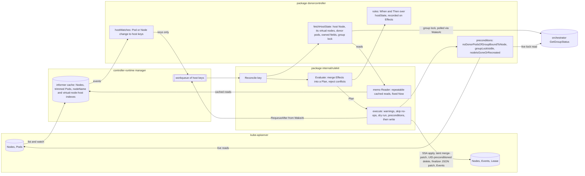

# Donor controller

The donor controller marks a real node (the *host*) as shared while an RL job's donor pods run on it, and unmarks it once the job is done with it:

1. **Share node while donor pods are bound.** Label the host `timeslice.io/donor=true` and `timeslice.io/group=<group>`, and add the isolation taint if configured. The guest-kubelet, gpu-shadow and snapshot-agent DaemonSets select on the donor label, so they follow it onto and off the host. The guest kubelet's virtual node therefore never keeps a host shared: it leaves when the label does.
2. **Reject donor pods outside the node's group.** A host belongs to one group at a time; the first group wins (the group label already on the Node, else the oldest donor pod's). Donor pods of another group, or without a valid group, get a `GroupConflict` or `InvalidGroup` Warning Event, on the pod and on the host, and change nothing.
3. **Keep the node shared** while its group's orchestrator lock is active or unknown (with `--orchestrator-addr`), and for an idle grace period after its last donor pod of the group left and the lock went idle. The start of the grace period is recorded in the `timeslice.io/idle-since` annotation, so it survives restarts.
4. **Unshare the node** once the grace period has elapsed, after live checks that no donor pod of the group has just been bound and that the lock is still idle.
5. **Release the virtual nodes of a dead host.** A virtual node is a Node labeled `timeslice.io/virtual-node=true` whose owner reference names its host, under any name (e.g. `vk-<hash>`). If that host Node is gone, or was recreated with a new UID, the controller deletes the virtual node and removes its `timeslice.io/virtual-node-protection` finalizer, which the guest kubelet, having died with the host, cannot do.

To run it, see the [KIND lab](../../guides/donor-controller/kind.md) and the [GKE guide](../../guides/donor-controller/gke.md).

## Packages

| Package | Role |
| --- | --- |
| `donorcontroller` (this directory) | What the controller does. [donorcontroller.go](donorcontroller.go) has `Setup`, the rule table and the helpers the rules use. [host.go](host.go) has the per-host snapshot (`hostState`), how it is fetched and watched, `TrimPod` and the shared label constants. |
| [`internal/rulekit`](internal/rulekit) | How it runs. A small engine on controller-runtime that fetches a snapshot, evaluates rules into a plan and executes it. The only code that talks to the API server. |

## Data flow



Reads go two ways: rules read only through the memoized cache reader, and only preconditions read the API server directly. The one input that is not a Kubernetes object, the group lock state, is read in `fetchHostState` and again live in a precondition; since nothing watches it, idle shared hosts poll it with `WakeAt`. Writes go one way: only `execute` in `internal/rulekit` writes.

## Release by omission

Rules never say "remove". Each reconcile computes the **complete** desired state of the host: the merge of every rule that fired. The engine server-side applies that merge as field manager `timeslice-donor-controller`. Any field the controller owned last time but no rule asserts this time is released by the apiserver, and fields owned by anyone else (hand-applied labels, kubelet, cloud provider) are never touched. That is why "unshare node after idle grace period" only records a precondition: once no rule asserts the labels and annotation, they go away.

Taints are the exception. `spec.taints` is an atomic list, so the isolation taint is declared in `Controller.ManagedTaints` and reconciled with a read-modify-write merge patch: present iff some rule asserted it. The patch is sent under the same field manager, so it shows up as a separate `Update` entry owning `f:spec.f:taints`.

A taint someone else owns is never part of the desired state. When its owner is gone for good, a rule can release it with `Effects.RemoveTaint`, the taint counterpart of `Effects.RemoveFinalizer`: a JSON patch that tests the Node's UID and the exact taint at its observed position before removing it, so it never removes a taint its owner re-added or changed. The stale GPU fence rule uses it for the guest kubelet's `timeslice.io/gpu-fence`.

Two rules setting the same field to different values is a bug. `Evaluate` fails with both rule names and the field path, and nothing is written. Every write emits a Kubernetes Event (`Applied`, `Tainted`, `Untainted`, `Deleted`, `FinalizerRemoved`) naming the rules that caused it; a removed foreign taint is an `Untainted` Event too. Warnings (`Effects.Warn`) are Events only: the engine emits each one once while a rule keeps asserting it, and again if it stops and recurs.

## Invariants

- **Level-triggered.** Watches only say which host to re-evaluate; they carry no data. A missed event is only delayed until the next event, resync or `WakeAt`.
- **One snapshot per reconcile.** Reads are memoized, and `Now` is fixed, so every rule decides on the same state.
- **Cache-only reads in rules.** Only preconditions read the API server, right before writing.
- **Declared reads only.** Reading a type no `Watch` covers is an error.
- **Writes pinned to what was observed.** Applies carry the observed `uid` and `resourceVersion`, so a stale cache can neither re-create a deleted Node nor overwrite a newer one. Deletes carry the observed UID; finalizer removals test the observed UID and the finalizer's position.

## Adding a rule

1. If the rule needs more cluster state, add it to `hostState` and `fetchHostState` in [host.go](host.go), and make sure a `Watch` covers its type.
2. Add a `rulekit.Rule[*hostState]` to `rules` in [donorcontroller.go](donorcontroller.go), with a `Name` that says what it does in the donor flow. The name shows up in logs, Events and errors.
3. Add a row to the table above `rules`, and a case to `TestRulesTable`.

```go
{
	Name: "drain guests from cordoned node",
	When: func(h *hostState) bool { return h.hostNodeExists() && h.Node.Spec.Unschedulable },
	Then: func(h *hostState, fx *rulekit.Effects) error {
		fx.Apply(corev1ac.Node(h.Host).WithLabels(map[string]string{...}))
		return nil
	},
},
```

## Operational notes

- **Virtual node liveness.** GKE's cloud controller manager deletes *NotReady* Nodes without a cloud instance within seconds. A guest kubelet that heartbeats stays Ready and is left alone; fake virtual nodes in tests set `spec.providerID: virtual-kubelet://<name>` so the CCM ignores them.
- **Pod cache.** Every pod is cached, trimmed by `TrimPod` to the few fields the controller reads. The rules read donor pods (`timeslice.io/donor=true`) and the guest kubelet's mirror pods (`timeslice.io/mirror-node` or `timeslice.io/role`), and no label selector matches both. Only pods of either kind trigger reconciles.
- **Orchestrator label shape.** Hosts carry `timeslice.io/group=<group>`. The orchestrator must read node groups in that shape (`--node-group-labels=ns` or `either`, from #208); main's orchestrator only reads `group.timeslice.io/<group>`.
- **Leader election.** `--leader-elect` uses the Lease `donor-controller.timeslice.io`.
